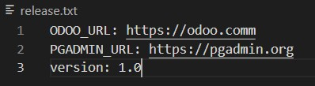

# 💻 Projets

## IC GROUP – Architecture CI/CD & Infrastructure as Code Multi-Serveurs

### Présentation du Projet
La société **IC GROUP** a mis en place un site web vitrine développé en Python/Flask servant de point d'entrée unique vers ses deux applications d'entreprise stratégiques :
1. **Odoo 13.0 (Édition Communautaire)** : Configuré et personnalisé avec son module LMS (Learning Management System) pour la gestion et la diffusion des formations internes.
2. **pgAdmin4** : Déployé pour assurer l'administration graphique et sécurisée de la base de données PostgreSQL d'Odoo.

L'objectif de ce projet a été de concevoir, provisionner et automatiser une infrastructure d'entreprise conteneurisée hautement disponible. Pour répondre aux besoins d'isolation des charges de travail et de sécurité, la solution est entièrement orchestrée et répartie de manière transparente sur **03 serveurs cloud distincts** (AWS EC2).

### Réalisations
* **Infrastructure as Code (IaC) :** Écriture et déploiement de scripts Terraform pour automatiser le provisionnement d'instances AWS EC2 (`t2.medium` et `t2.micro`) et la configuration dynamique des règles de pare-feu (Security Groups).
03 serveurs hébergées soit dans le cloud AWS:
        1) **Serveur 1** : Jenkins (AWS, t2.medium, docker_jenkins)
        2) **Serveur 2** : Applications web site vitrine + pgadmin4 (AWS, t2.micro)
        3) **Serveur 3** : Application Odoo (AWS, t2.micro)
* **Gestion de Configuration et Provisioning :** Création de playbooks Ansible pour automatiser l'installation complète de l'écosystème Docker/Docker Compose sur des instances vierges.
* **Industrialisation par Rôles Ansible :** Modélisation de rôles Ansible hautement réutilisables (`odoo_role` et `pgadmin_role`) s'appuyant sur des templates Docker Compose configurés dynamiquement avec Jinja2 (volumes persistants, isolation réseau et services configurables).
* **Conteneurisation et Scripting Avancé :** Optimisation d'un Dockerfile Python/Flask utilisant des variables d'environnement dynamiques extraites à la volée via des scripts Linux (`awk`) à partir d'un fichier de configuration centralisé (`releases.txt`).
* **Pipeline CI/CD Unifié (Jenkins) :** Conception d'un pipeline complet structuré en étapes (Extraction, Multi-Build avec arguments, Tests fonctionnels automatisés via curl/inspect, Push Docker Hub et Déploiement automatique via Ansible).



### Architecture du Projet & Arborescence
```text
.
├── ansible/
│   ├── inventory.ini
│   └── playbooks/
│       ├── provision.yml
│       └── deploy.yml
│   └── roles/
│       ├── odoo_role/
│       │   ├── defaults/
│       │   │   └── main.yml
│       │   ├── tasks/
│       │   │   └── main.yml
│       │   └── templates/
│       │       └── docker-compose-odoo.yml.j2
│       └── pgadmin_role/
│           ├── defaults/
│           │   └── main.yml
│           ├── tasks/
│           │   └── main.yml
│           └── templates/
│               └── docker-compose-pgadmin.yml.j2
├── terraform/
│   ├── main.tf
│   ├── variables.tf
│   └── outputs.tf
├── Dockerfile
├── Jenkinsfile
└── releases.txt
```

## Problématiques & Défis Techniques
**Isolation et Optimisation des Ressources :** Odoo et PostgreSQL étant gourmands en ressources, le défi consistait à isoler l'ERP sur un serveur dédié tout en maintenant le site vitrine et pgAdmin sur une autre instance pour garantir la haute disponibilité du site institutionnel.

**Dynamisation des Déploiements :** Permettre aux équipes produit de modifier les URLs de redirection ou la version de l'application sans jamais toucher au code source ou perturber la configuration réseau.

**Stratégie Multi-Environnement :** Assurer la portabilité totale des recettes de déploiement Ansible afin de pouvoir basculer l'infrastructure d'un environnement Cloud (AWS EC2) vers du On-Premises sans modifier la logique des rôles.

## Métriques & Impact Business
**Automatisation à 100% (Zero-Human-Error) :** Le provisioning complet (de la machine vide à l'application fonctionnelle) s'exécute de manière idempotente sans aucune action manuelle.

**Livraison Continue Sécurisée :** Intégration de tests de validation (Health Checks HTTP et validation d'environnement) bloquant automatiquement le pipeline et empêchant l'application de passer en production en cas de crash.

**Flexibilité Commerciale :** Réduction drastique du "Time-to-Market" pour le déploiement de nouvelles versions applicatives (v1.0 à v1.1) simplement en poussant un tag textuel.

**Tech Stack du projet :** AWS EC2 • Terraform • Ansible • Jenkins • Docker • Docker Compose • Python (Flask) • Odoo 13 • pgAdmin4 • Linux (Bash/Awk) • Git

## Guide de Déploiement (Pas-à-Pas)
**Étape 1 :** Initialisation de l'Infrastructure (Terraform)
Cretion des 3 serveurs sur AWS :

```Bash
cd terraform/
terraform init
terraform plan
terraform apply -auto-approve
```

**Étape 2 :** Configuration de l'Inventaire Ansible
Ouvrez le fichier ansible/inventory.ini et mettez à jour les adresses IP fournies par Terraform :

```text
Ini, TOML
[serveur_2]
<IP_WEBAPP_TERRAFORM> ansible_user=ubuntu ansible_ssh_private_key_file=~/.ssh/ma-cle-aws.pem

[serveur_3]
<IP_ODOO_TERRAFORM> ansible_user=ubuntu ansible_ssh_private_key_file=~/.ssh/ma-cle-aws.pem
```

**Étape 3 :** Provisioning des Serveurs via Ansible
Installez automatiquement Docker et Docker Compose sur les instances applicatives :

```Bash
ansible-playbook -i ansible/inventory.ini ansible/playbooks/provision.yml
```

**Étape 4 :** Configuration Globale & CI/CD Jenkins
Accédez à l'interface Jenkins : http://<IP_JENKINS_TERRAFORM>:8080.

Configurez vos identifiants Docker Hub dans Jenkins sous l'ID docker-hub-credentials.

Créez un projet de type Pipeline, liez votre dépôt Git et lancez le Build.

**Étape 5 :** Validation de la Recette (Captures d'écran finales)

Vérifiez l'accessibilité de vos services dans votre navigateur :

**Site Vitrine Flask :** http://<IP_SERVEUR_2>:8080

**Interface pgAdmin4 :** http://<IP_SERVEUR_2>:5050

**ERP Odoo 13 :** http://<IP_SERVEUR_3>:8069

## Nettoyage des Ressources
Pour détruire l'ensemble de l'infrastructure et éviter toute facturation sur votre compte AWS :

```Bash
cd terraform/
terraform destroy -auto-approve
```
